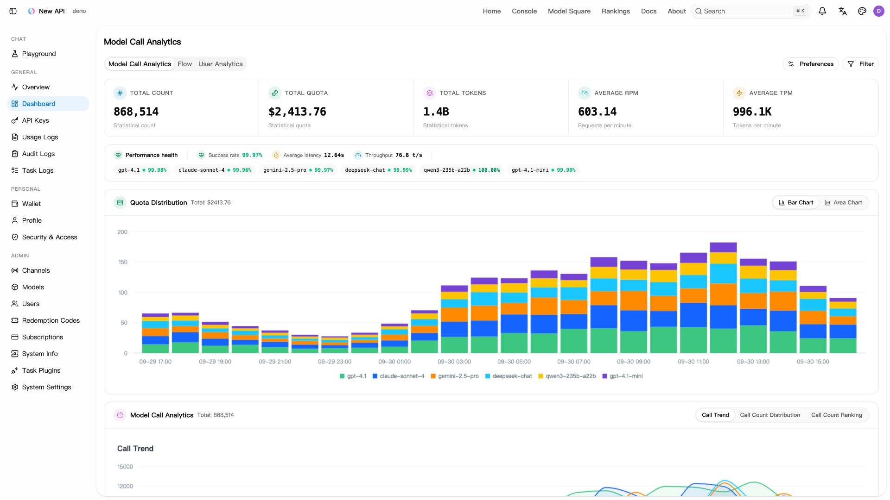
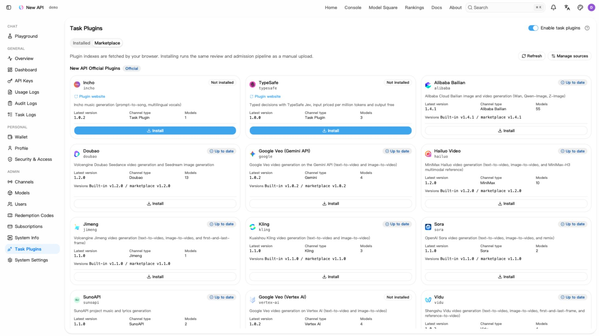

<div align="center">

# YMeng CC New API


<h2><a href="https://ymeng.cc">YMeng API 中转站 · ymeng.cc</a></h2>

<p><strong>访问中转站：<a href="https://ymeng.cc">https://ymeng.cc</a></strong></p>

**An AI gateway for models, applications, and agents**

为 YMeng API 中转服务开发与维护的 New API 二次开发版本

**渠道路由 · 云猫支付 · 发票管理 · 邀请返佣 · 上游成本分析**

[本仓库](https://github.com/atelier-of-dongn/YMeng-CC-New-API) | [上游项目](https://github.com/QuantumNous/new-api) | [简体中文上游介绍](./README.zh_CN.md) | [English](./README.en.md)

[分支说明](#fork-overview) | [首页与近期功能](#fork-home) | [分支部署](#fork-deployment) | [使用流程](#fork-usage) | [常见问题](#fork-faq) | [上游参考](#upstream-reference)

</div>

<a id="fork-overview"></a>

## 分支说明

本仓库是 [QuantumNous/new-api](https://github.com/QuantumNous/new-api) 的二次开发版本。下方先介绍本分支的使用方式，再保留上游功能、部署参考与致谢信息。

> [!IMPORTANT]
> 上游官方镜像 `calciumion/new-api:latest` 不包含本仓库的定制修改。部署前请确认使用的代码分支和镜像来源；下方上游快速开始仅用于部署官方 New API。

<a id="fork-home"></a>

### 首页与近期功能

首页（`/`）经过整体改版，面向两类访问者：

| 区域 | 内容 |
| --- | --- |
| 首屏斜线分割 | 桌面端以斜向接缝分为左右两部分（约 42% / 58%），中间为 `×` 接缝徽章；移动端开发者入口排在前面 |
| 小白入口（左） | 纸感风格的「{{站点名称}} × BaoCode」面板，通用注册用户可直接上手 |
| 开发者入口（右） | 深色控制台风格面板，登录后进入仪表盘，未登录时显示登录入口 |
| 社区角 | 右上斜切区域展示 QQ 群 / Telegram 群入口与话题标签，链接由后台配置，留空时自动隐藏 |
| 后续区块 | 统计、核心能力、工作原理、价格、常见问题，以及未登录时底部的开始使用引导 |

#### BaoCode 入门通道

- 访问 [baocode.dev](https://baocode.dev/?ymengcc) 下载 BaoCode（macOS / Windows / Linux），或使用首页「获取 BaoCode」按钮。
- 安装后直接使用本站账号登录，无需自行申请 API Key 或填写接口地址。
- 在 BaoCode 中选择模型即可开始对话与编写代码；可用模型取决于账号分组与站点配置。

#### BaoCode 优势卡

小白入口顶部展示 BaoCode 的对比数据：启动约 `0.18 s`（Cursor 为 `2–3 s`）、空闲内存约 `120 MB`（Cursor 为 `1.9 GB`），另有相对 Claude Code、Codex、Cursor 的三点差异（可视化界面、单应用接入多模型、原生应用）。以上数值来自 BaoCode 官方基准，可能随版本变化；请以 BaoCode 官网为准。

首页文案与数据位于 `web/src/features/home/`，对应中文文案见 `web/src/i18n/locales/zh.json`。

### 本分支功能

本分支直接集成在 New API 网关中，沿用其请求转发、流式输出、管理员认证与设置存储，不是独立部署的外置代理。

| 功能 | 说明与使用入口 |
| --- | --- |
| [首页与 BaoCode 入口](#fork-home) | 斜线分割首屏，BaoCode 小白通道与开发者控制台入口，详见上文「首页与近期功能」 |
| [云猫寄售店铺支付](#fork-catfk) | 钱包内获取实时报价、扫码付款，自动查单与兑换入账，支持手续费展示及订单兑换记录 |
| [云猫微信支付](#fork-catfk) | 支付弹窗按所选支付方式展示支付宝或微信收款码；手机端微信支付支持保存二维码 |
| [渠道优先级拖拽](#fork-channel-priority) | 卡片与表格视图拖拽调整优先级，支持同级合并、自动保存及撤销最近一次保存 |
| [发票申请与管理](#fork-invoices) | 用户选择充值订单申请发票；管理员处理、驳回、上传 PDF，支持搜索、预览下载、Excel 导出与开票邮件 |
| [邀请消费返佣](#fork-affiliate) | 邀请链接、受邀用户与佣金明细，按钱包消费结算推广佣金，推广额度可转入钱包 |
| [管理员推荐看板](#fork-affiliate) | 按时间查看推荐注册与佣金统计、趋势、邀请人排行，搜索与筛选佣金明细 |
| [API Key 有序多分组](#fork-key-routing) | 配置分组调用顺序，开启跨组重试后按顺序切换分组，跳过无可用渠道的分组 |
| [日志请求参数追溯](#fork-operations) | 在日志详情查看与复制保存的请求参数，并显示截断或省略提示 |
| [网页地区可见性](#fork-region) | 根据可信边缘国家码过滤大陆访客的网页分组与模型展示；模型 API 调用不受限制 |
| [上游自动监控与倍率成本](#fork-cost) | 查看兼容 New API 上游的分组、倍率、余额与定价状态，估算成本并匹配上游消费日志 |
| [收益与内部账号盈亏](#fork-cost) | 管理员查看收入、成本、利润、毛利率、覆盖率，可切换内部账号消费的统计口径 |
| [固定按请求成本](#fork-cost) | 配置渠道固定 `USD/request` 采购成本，适用于按次采购的上游服务 |
| [日志响应模型开关](#fork-operations) | 控制普通用户日志及导出是否显示响应模型与模型不一致警告；管理员始终可见，已存日志不变 |
| [QQ / Telegram 交流群入口](#fork-operations) | 首页社区角展示群入口，在站点设置的系统信息中配置群链接，留空即隐藏 |
| [运营告警与站点配置](#fork-operations) | 飞书成本告警、自定义顶部导航与排序、按支付方式设置充值提示 |

以上云猫支付、发票、返佣、渠道拖拽、日志响应模型、上游成本分析与新首页均为本分支自有实现，上游官方镜像不包含这些功能。

### 分支与版本

`ip-policy` 为仓库默认分支，包含上表全部功能。固定 `USD/request` 上游采购成本模式已合入默认分支，无需切换功能分支。生产部署建议记录并使用经过验证的具体提交或标签。

### 继承上游的基础能力

除上述定制功能外，本仓库保留 New API 的多模型接入、协议转换、渠道管理、用户与额度管理等基础能力：

- **认证与安全管理**：登录设备与会话管理、Passkey、TOTP、面板 Access Token 及审计日志。用户入口 `/security`，审计日志入口 `/usage-logs/audit`；详见[认证与登录会话说明](./docs/authentication.md)。
- **任务插件与任务管理**：超级管理员通过 `/task-plugins` 管理插件版本、启停、激活与试运行，渠道可绑定任务插件。插件接入规范见 [Task Plugin API v1](./docs/plugin-api/v1.md)，具体服务能力由安装的插件提供。
- **表达式定价**：支持阶梯、缓存、多模态、时间条件与任务用量等计费表达式，并可配置零输出 Token 时的计费策略。详见[计费表达式说明](./pkg/billingexpr/expr.md)。用户侧计费与上游采购成本分别配置。

> [!NOTE]
> “记录每次请求的成本”与“按请求固定单价”是两个概念。倍率模式也记录请求成本；按请求模式则不按 Token 用量计算，而使用管理员填写的固定单价。上游成本监控不替代用户侧计费规则。

现有 `newapi-affiliate` 镜像不会因为克隆本仓库而自动更新；请分别管理已有实例与本分支构建的镜像。

<a id="fork-deployment"></a>

## 分支部署

### 从本仓库构建

需要 Git、Docker 与 Docker Compose v2。镜像构建会同时编译前端和 Go 后端，无需在宿主机单独安装 Bun 或 Go。

```bash
# 克隆默认分支
git clone --branch ip-policy https://github.com/atelier-of-dongn/YMeng-CC-New-API.git
cd YMeng-CC-New-API

# 记录部署版本；生产环境建议检出经过验证的具体提交或标签
git rev-parse HEAD
docker build -t new-api-ip-policy:local .
```

在仓库的 `docker-compose.yml` 中，将 `new-api` 服务的 `image` 改为本地构建的镜像：

```yaml
services:
  new-api:
    image: new-api-ip-policy:local
```

以上只展示需要修改的字段，**不是完整 Compose 配置**。保留仓库文件中的其他服务、环境变量、挂载与网络配置。该模板默认使用 PostgreSQL 与 Redis；原有 `calciumion/new-api:latest` 是上游官方镜像，不包含本分支修改。

启动前检查：

- 修改 PostgreSQL 与 Redis 的示例密码，并同步修改 `SQL_DSN`、`REDIS_CONN_STRING` 中的凭据。
- 保留 `./data:/data`、`./logs:/app/logs` 与数据库持久化卷；升级前备份数据库、数据目录和部署配置。
- 生产环境通过 HTTPS 反向代理访问，设置随机且稳定的 `SESSION_SECRET`，按下方环境变量说明配置 Secure Cookie 与可信 Origin。
- 根据实际代理拓扑配置 `TRUSTED_PROXIES`，限制源站直连；地区国家码必须由可信边缘节点提供。
- 现有部署升级前先在测试实例验证。不要删除数据库卷，也不要在生产数据上直接尝试未经验证的降级。

```bash
docker compose config --quiet
docker compose up -d
docker compose ps
curl -fsS http://localhost:3000/api/status
```

访问 `http://localhost:3000` 完成初始化。状态接口应返回 `success: true`；还应登录后台检查分支功能是否存在，避免误用上游镜像。

### 多节点运行

所有节点使用相同版本、主数据库与 `SESSION_SECRET`；共享 Redis 的节点还需使用一致的 `CRYPTO_SECRET`。每个节点记录自己转发请求的成本，上游轮询由主节点执行，部署时需确保有主节点运行。认证与缓存传播的详细说明见下方多机部署参考。

### 托管在线更新（可选）

需要在已有 Nginx/宝塔反向代理后接入双实例模式时，使用 `docker-compose.managed.yml`。该模板让代理先把新请求送到已通过健康检查的新实例，再让旧实例继续完成已建立的 HTTP/SSE/WebSocket 连接；不使用 `docker compose down`，也不会删除数据卷、数据库或 Redis。

启用前必须完成以下条件：

- `NEW_API_IMAGE` 使用已验证的不可变 digest；两实例共享主数据库、日志数据库、Redis、`SESSION_SECRET`、`CRYPTO_SECRET` 和 `update_assets` 卷。
- 设置随机且仅用于内部网络的 `UPDATE_CONTROL_TOKEN`，以及与发布清单匹配的 `UPDATE_RELEASE_PUBLIC_KEY`；控制器是唯一允许挂载 Docker socket 的服务。
- 先让 Nginx/宝塔指向代理的 `3000` 端口，再从后台更新入口执行检查。没有签名兼容清单、数据库/schema/缓存兼容性证据或候选实例 readiness 时，安装按钮会保持禁用。
- 旧实例不会因固定超时被强制关闭；长连接或计费写入未完成时会保留旧实例并显示排空状态。更新失败时继续使用旧实例。

首次把直接访问 `new-api:3000` 的站点迁移到代理入口，必须先在独立端口验证并通过 Nginx graceful reload；不能保证改入口本身不影响已有连接。SQLite、破坏性 schema 迁移和未验证的后台任务交接不支持在线安装。必须先在测试环境验证，再处理生产入口。

<a id="fork-usage"></a>

## 使用流程

### 常用入口

以下路径相对于你部署的站点地址；菜单可见性取决于账号权限与站点配置。

| 操作 | 入口 |
| --- | --- |
| BaoCode 入门通道与开发者入口 | 首页 `/` |
| QQ / Telegram 群链接配置 | `/system-settings/site/` 的“系统信息” |
| 日志响应模型显示 | `/system-settings/operations/logs` 的“日志维护” |
| 用户钱包充值与订单历史 | `/wallet` |
| 云猫支付配置 | `/system-settings/billing/payment` 的“云猫寄售店铺支付”标签 |
| 渠道优先级拖拽 | `/channels` 的“拖拽模式” |
| 分类通知设置 | `/profile` 的设置卡片 |
| 用户发票申请与下载 | `/invoices` |
| 管理员发票处理 | `/admin-invoices` |
| 用户邀请与佣金明细 | `/affiliate`，钱包中的推广奖励卡片 |
| 管理员推荐统计 | `/affiliate-admin` |
| API Key 分组顺序与跨组重试 | `/keys` 的新建或编辑窗口 |
| 上游收益、内部账号盈亏与请求参数 | 管理员使用日志及日志详情 |
| 返佣比例、成本监控、导航和充值提示 | 管理后台对应设置栏目 |

<a id="fork-catfk"></a>

### 云猫寄售店铺支付

#### 管理员配置

1. 超级管理员进入“系统设置 → 计费设置 → 支付网关”，完成页面要求的合规确认，打开“云猫寄售店铺支付”标签。
2. 在运行后端的环境中设置 `CATFK_ORDER_ENCRYPTION_KEY`：值为 Base64 编码，解码后必须是 32 字节。妥善保管该密钥，不要提交到仓库或放入前端配置。
3. 填写店铺令牌，配置商品映射：唯一 ID、名称、`goods_key` 和预期到账美元余额。到账金额须匹配“通用”中的充值预设金额；每单购买一个兑换码，不支持自定义充值金额。
4. 使用“读取云猫渠道”选择支付渠道，启用后点击“保存全部设置”。店铺令牌留空会保留已保存值，不应填写用户会话密钥。

#### 用户付款与到账

1. 在钱包 `/wallet` 选择已映射的充值预设金额和云猫支付方式。
2. 查看实时人民币报价，填写 5–12 位 QQ 联系号码并确认，在站内弹窗使用支付宝扫码付款。报价包含手续费信息时，确认页和待支付页会展示费率及手续费。
3. 系统自动检查订单、付款与发货状态，并处理兑换码入账。“已收到付款”不等于已入账，订单完成后才显示支付成功并刷新余额。
4. 在钱包历史记录中查看订单状态及本人已完成订单的兑换记录，可查看、复制已使用的兑换码；该码已经兑换，不能再次使用。

关闭付款弹窗不会停止服务器处理订单。停用云猫支付只停止创建新订单，已有订单仍会继续处理。云猫订单不能通过管理员补单功能手动完成；付款后未到账时，应保留订单号并检查订单状态，不要反复付款。

<a id="fork-channel-priority"></a>

### 渠道优先级拖拽

具有渠道编辑权限的账号可在 `/channels` 使用卡片或表格视图调整优先级：

1. 按“优先级”排序，并关闭标签分组。
2. 开启“拖拽模式”，将渠道拖到层级之间以插入新优先级，或拖到目标中央加入同一优先级。
3. 每次有效放下后自动保存；需要恢复时，可撤销最近一次保存。“完成排序”用于退出拖拽模式，无需另行提交。

<a id="fork-invoices"></a>

### 发票申请与管理

1. 用户进入“发票”，选择符合条件的成功充值订单，填写发票抬头和税号后提交申请。
2. 系统计算可申请净额并扣减相关退款；当前申请净额须大于 500，具体可选订单以页面结果为准。
3. 管理员在发票管理中处理申请，可填写原因驳回，或上传开具好的 PDF 完成发票交付。
4. 用户可查看状态、预览和下载 PDF；管理员可搜索申请、导出 Excel，开票后系统尝试通过邮件发送发票。

这是发票申请和文件交付流程。实际开票由运营方完成；邮件交付需要正确配置邮件服务，发送失败时仍可从页面下载。

<a id="fork-affiliate"></a>

### 邀请消费返佣与推荐看板

1. 管理员在计费设置的“推广佣金”中启用返佣，并配置消费佣金比例。
2. 用户在邀请页面获取邀请链接，查看受邀用户、消费佣金明细和推广额度，可将推广额度转入钱包使用。
3. 管理员在推荐看板按时间范围查看推荐注册、已完成佣金、趋势与邀请人排行，并搜索、筛选明细。

配置项为 `affiliate_setting.enabled` 和 `affiliate_setting.commission_rate_percent`。佣金按受邀用户的**钱包余额消费**结算，订阅额度消耗不计佣。推广额度转入钱包供站内使用，页面不提供现金提现流程。

<a id="fork-key-routing"></a>

### API Key 有序分组与跨组重试

在令牌的新建或编辑窗口配置分组序列，并调整调用顺序。请求优先选择序列靠前的可用分组；当前模型或路径没有可用渠道的分组会被跳过。

开启“跨分组重试”后，当前组的重试预算耗尽可进入下一组。组内重试次数仍由系统的失败重试配置控制；跨组重试不保证上游请求必然成功，建议结合日志检查最终使用的分组和渠道。

<a id="fork-region"></a>

### 网页地区可见性

1. 在管理后台的安全设置中打开“大陆 IP 网页可见性”。
2. 启用“大陆 IP 网页过滤”，选择允许大陆访客查看的分组并保存。
3. 通过可信边缘节点分别以大陆与非大陆来源访问，检查网页模型与分组展示。

| 配置项 | 说明 |
| --- | --- |
| `IpAccessPolicyEnabled` | 网页过滤开关，默认关闭 |
| `IpAccessPolicyAllowedGroups` | 允许展示的分组，保存格式为 JSON 字符串数组，例如 `["default", "domestic"]` |

国家码优先读取 `X-Client-Country`，其次读取 `CF-IPCountry`。应用不会自行执行 GeoIP 查询；只有开启过滤且国家码为 `CN` 时生效，国家码缺失或未知时不进行地区过滤。

> [!WARNING]
> 国家码请求头不是客户端身份凭据。边缘节点应覆盖客户端自行提交的这两个请求头，并限制绕过边缘直接访问源站。`TRUSTED_PROXIES` 不会自动验证国家码头的来源。此功能只控制网页可见性，不能作为 API 授权、防火墙或合规准入机制。

<a id="fork-cost"></a>

### 上游成本监控与收益分析

默认分支同时支持倍率与固定按请求两种上游成本计算方式。

1. 在“运营设置 → 日志维护”开启“记录额度消费”，保证消费日志可用。
2. 在“运营设置 → 上游成本监控”开启全局监控，按需配置自动发现、轮询周期与飞书通知。
3. 在渠道的上游监控设置中选择自动、手动或关闭，并选择成本计算方式。
4. 倍率模式下，自动模式尝试识别兼容的 New API 上游；无法自动获取时，可使用手动倍率。选择按请求模式时，填写固定的 `USD/request` 单价。
5. 查看渠道监控详情与管理员使用日志，结合成本状态和覆盖率解读收益数据。

| 成本计算方式 | 数据来源 | 适用场景与限制 |
| --- | --- | --- |
| 倍率 | 上游定价、分组倍率或手动倍率；可匹配的上游消费日志 | 自动监控依赖上游接口兼容性和权限；未匹配的记录仍为估算 |
| 按请求 | 管理员设置的固定美元单价 | 每条消费日志记录一次固定成本，包括任务提交；后续调整和退款不会改变该固定成本，不参与上游日志匹配 |

默认配置：

| 设置 | 默认值 |
| --- | --- |
| 全局监控 | 关闭 |
| 自动发现 | 开启，但需先启用全局监控 |
| 日志轮询周期 | 60 秒 |
| 定价刷新周期 | 5 分钟 |
| 成本记录保留期 | 30 天 |
| 飞书通知 | 未配置，按需启用 |

> [!IMPORTANT]
> 成本记录可能处于已匹配、估算或未知状态。固定按请求成本始终属于配置估算；未知或未覆盖的请求不能当作零成本。收益数据应结合覆盖率、筛选范围与记录保留期使用，不应视为上游账单或最终结算凭据。

#### 内部账号盈亏口径

管理员使用日志中的“内部账号盈亏”开关默认关闭，并在浏览器本地保存偏好。开启后，内部账号的请求保留上游成本、不计收入，便于把自用消耗纳入运营盈亏。当前内部账号固定为用户 ID `1`；统计时仍需关注估算、未知成本与覆盖率。

<a id="fork-operations"></a>

### 日志追溯与运营配置

- **请求参数追溯**：在使用或任务日志详情查看、复制保存的请求参数；参数被截断或省略时会显示提示。排查问题时结合请求 ID、渠道与任务状态使用，保存内容不保证是完整原始请求。
- **日志响应模型开关**：在“系统设置 → 运营设置 → 日志维护”中控制普通用户的日志及导出是否显示响应模型与模型不一致警告。关闭后管理员仍可查看，已存储的日志不受影响。
- **交流群入口**：在“站点设置 → 系统信息”中填写 QQ 群链接与 Telegram 群链接，首页社区角据此展示对应入口；留空即隐藏。
- **分类通知**：在 `/profile` 的设置卡片中，分别控制余额不足提醒、渠道通知和上游模型更新通知，修改后点击“保存设置”。余额提醒依赖站点启用相应功能；渠道通知和上游模型更新通知仅管理员可见。
- **顶部导航**：在站点设置中配置自定义导航链接、显示方式与排序。
- **充值提示**：在支付方式配置中设置提示文字、链接、图片与显示开关，为不同支付方式提供对应说明。
- **飞书告警**：在上游成本监控设置中配置机器人 Webhook 与签名密钥，使用测试通知检查配置，再关注倍率变化与成本异常。

<a id="fork-faq"></a>

## 常见问题

| 问题 | 检查项 |
| --- | --- |
| 部署后看不到分支功能 | 确认检出的分支和提交，检查 Compose 是否仍指向上游官方镜像，重新构建并更新容器 |
| 首页看不到 QQ / Telegram 群入口 | 在站点设置的系统信息中填写群链接；留空时入口自动隐藏 |
| 普通用户日志看不到响应模型 | 检查日志维护中的“向普通用户显示响应模型”；关闭后普通用户及导出结果隐藏该信息，管理员始终可见 |
| 没有按请求成本选项 | 更新默认分支代码并重新构建镜像，确认运行容器使用的是更新后的镜像 |
| 云猫支付方式没有显示 | 检查合规确认、支付开关、店铺令牌、支付渠道、商品映射及 `CATFK_ORDER_ENCRYPTION_KEY`；充值金额须匹配已映射的预设金额 |
| 云猫已付款但余额未更新 | 等待订单完成付款、发货核验与兑换入账，查看钱包订单状态；保留订单号，不要重复付款，也不要使用管理员手动补单 |
| 渠道拖拽模式不可用 | 检查渠道编辑权限，按优先级排序并关闭标签分组 |
| 发票申请无法提交 | 检查抬头、税号、可选充值订单与退款扣减后的净额；当前净额须大于 500 |
| 邀请用户消费后没有佣金 | 检查推广佣金开关、比例及邀请关系；只有钱包余额消费计佣，订阅额度消耗不计佣 |
| 大陆网页过滤没有生效 | 确认开关、允许分组，以及源站收到的国家码是否为 `CN` |
| 模型 API 仍可调用 | 这是预期行为；网页地区可见性不限制 API 调用 |
| 使用日志没有上游成本 | 检查消费日志开关、全局监控、渠道监控模式与成本参数；新配置不会自动补齐所有历史成本 |
| 自动模式显示未知 | 检查上游是否兼容、接口是否可访问、密钥权限与主节点运行情况；查看渠道详情中的错误信息 |
| 毛利统计与账单不一致 | 检查估算状态、覆盖率、时间范围、保留期，以及上游折算配置；按请求成本不会随退款自动调整 |

分支相关问题请在[本仓库 Issues](https://github.com/atelier-of-dongn/YMeng-CC-New-API/issues)中反馈，附上部署提交、复现步骤与脱敏日志。下方官方文档、发行版和社区链接属于上游 New API，未必涵盖本分支的定制功能。

<a id="fork-partners"></a>

## 🤝 值得信赖的合作伙伴

<p align="center">
  <a href="https://baocode.dev" target="_blank">
    
  </a><!--
  --><a href="https://github.com/leookun/cursor-byok" target="_blank">
    
  </a>
</p>

<a id="upstream-reference"></a>

## 上游参考

以下保留上游 New API 的功能介绍、部署示例、相关项目、许可与致谢。**其中克隆上游仓库、拉取官方镜像或应用商店安装的命令，仅适用于上游版本。部署本分支请使用上面的分支部署流程。**

<div align="center">

## 上游项目入口

<p align="center">
  <a href="https://raw.githubusercontent.com/Calcium-Ion/new-api/main/LICENSE">
    
  </a><!--
  --><a href="https://github.com/Calcium-Ion/new-api/releases/latest">
    
  </a><!--
  --><a href="https://hub.docker.com/r/CalciumIon/new-api">
    
  </a>
  <a href="https://atomgit.com/QuantumNous/new-api" target="_blank">
    
  </a>
</p>

<p align="center">
  <a href="https://trendshift.io/repositories/20180" target="_blank">
    
  </a>
  <br>
  <a href="https://hellogithub.com/repository/QuantumNous/new-api" target="_blank">
    
  </a><!--
  -->
  <a href="https://atomgit.com/QuantumNous/new-api" target="_blank">
    
  </a>
</p>

<p align="center">
  <a href="#screenshots">Screenshots</a> •
  <a href="#capabilities">Capabilities</a> •
  <a href="#quick-start">Quick start</a> •
  <a href="#deployment">Deployment</a> •
  <a href="#development">Development</a> •
  <a href="#documentation">Documentation</a>
</p>

</div>

---

## 📝 Project Description

New API is a self-hosted AI gateway for applications, agents, and teams. Connect upstream model services, expose a consistent API to your clients, and manage routing, access, usage, and costs in one place.

Use it to share authorized model access across a team, switch providers without configuring every client again, or operate a private multi-model service with a web console. Upstreams include OpenAI, Anthropic, Google Gemini, Azure OpenAI, AWS Bedrock, Vertex AI, DeepSeek, Qwen, and other compatible services.

> [!IMPORTANT]
> - This project is intended solely for lawful and authorized AI API gateway, organization-level authentication, multi-model management, usage analytics, cost accounting, and private deployment scenarios.
> - Users must lawfully obtain upstream API keys, accounts, model services, and interface permissions, and must comply with upstream terms of service and applicable laws and regulations.
> - Users should ensure their use complies with upstream terms of service and applicable laws and regulations.
> - When providing generative AI services to the public, users should comply with applicable regulatory requirements and fulfill all filing, licensing, content safety, real-name verification, log retention, tax, and upstream authorization obligations required by their jurisdiction.

<!-- -->

> [!WARNING]
> When operating this project as a public generative AI service or API resale service, users should first complete all required filing, licensing, content safety, real-name verification, log retention, tax, payment, and upstream authorization obligations.

---

<a id="screenshots"></a>

## Screenshots

Accounts, channels, plugin installation states, usage, prices, and costs shown below are simulated data. The marketplace displays the official plugin catalog. Click an image to view it at full size.

| Usage dashboard | Plugin marketplace |
| --- | --- |
| [](assets/screenshots/dashboard.en.jpg) | [](assets/screenshots/plugin-marketplace.en.jpg) |
| **Model square** | **Usage logs** |
| [](assets/screenshots/models.en.jpg) | [](assets/screenshots/usage-logs.en.jpg) |

---

## 🤝 Trusted Partners

<p align="center">
  <em>No particular order</em>
</p>

<p align="center">
  <a href="https://www.cherry-ai.com/" target="_blank">
    
  </a><!--
  --><a href="https://github.com/iOfficeAI/AionUi/" target="_blank">
    
  </a><!--
  --><a href="https://bda.pku.edu.cn/" target="_blank">
    
  </a><!--
  --><a href="https://www.aliyun.com/" target="_blank">
    
  </a><!--
  --><a href="https://io.net/" target="_blank">
    
  </a>
</p>

---

## 🙏 Special Thanks

<p align="center">
  <a href="https://www.jetbrains.com/?from=new-api" target="_blank">
    
  </a>
</p>

<p align="center">
  <strong>Thanks to <a href="https://www.jetbrains.com/?from=new-api">JetBrains</a> for providing free open-source development license for this project</strong>
</p>

---

<a id="capabilities"></a>

## Capabilities

| Area | What you can do |
| --- | --- |
| Model access | Use OpenAI Chat Completions, Responses, Anthropic Messages, and Gemini APIs; stream responses and use tools, reasoning, and multimodal inputs where supported |
| Routing | Configure model mappings, channel priorities and weights, retries, channel affinity, and multiple upstream keys |
| Usage and costs | Manage quotas, subscriptions, usage logs, cache accounting, and expression-based pricing for different usage tiers |
| Access control | Manage users, groups, fine-grained permissions, and API key restrictions; use OAuth/OIDC, passkeys, two-factor authentication, and login session management |
| Asynchronous tasks | Extend image, video, and other task APIs with JavaScript plugins, including task status and output retrieval |
| Web console | Configure channels and models, inspect usage and audit logs, and try models in the playground; available in English, Simplified Chinese, Traditional Chinese, French, Japanese, Russian, and Vietnamese |

### Protocols and endpoints

| Interface | Common endpoints |
| --- | --- |
| OpenAI Chat / Responses | `POST /v1/chat/completions`, `POST /v1/responses` |
| Anthropic Messages | `POST /v1/messages` |
| Gemini | `POST /v1beta/models/{model}:generateContent`, `POST /v1beta/models/{model}:streamGenerateContent` |
| Realtime / Responses WebSocket | `GET /v1/realtime`, `GET /v1/responses` (WebSocket upgrade) |
| Images / audio | `/v1/images/generations`, `/v1/images/edits`, `/v1/audio/speech`, `/v1/audio/transcriptions`, `/v1/audio/translations` |
| Embeddings / rerank | `POST /v1/embeddings`, `POST /v1/rerank` |
| Task plugins | `POST /v1/tasks/{pluginKey}`, `GET /v1/tasks/{taskId}`, plus routes declared by each plugin |

[RelayKit](./relaykit/README.md) provides request, response, and streaming conversion between the four text protocols. Available features depend on the channel, upstream model, and conversion path; protocol-specific tools and fields may not map exactly. WebSocket support also requires a compatible upstream and channel configuration.

This README describes the current source tree. Check the release notes for the version you deploy.

<a id="quick-start"></a>

## Quick start

### Try locally with Docker

This starts a single instance with SQLite and binds it to localhost:

```bash
mkdir -p data
docker run --name new-api -d --restart unless-stopped \
  -p 127.0.0.1:3000:3000 \
  -e TZ=Asia/Shanghai \
  -v "$(pwd)/data:/data" \
  calciumion/new-api:latest
```

Open [http://localhost:3000](http://localhost:3000) and complete the setup wizard to create the administrator account. The `data` directory persists the SQLite database across container replacements.

### Make your first request

1. Add a channel with your upstream API key, available models, and group assignment; run a channel test.
2. Configure model pricing and ensure the user has quota or a valid subscription.
3. Create an API key in the console with access to the same group and models.
4. Set your client's base URL to `http://localhost:3000/v1` for OpenAI-compatible clients and use the **New API-issued key**.

Set `NEW_API_KEY` in your shell to that key. List the models accessible to it:

```bash
curl --fail-with-body http://localhost:3000/v1/models \
  -H "Authorization: Bearer ${NEW_API_KEY}"
```

Then call Responses, replacing `your-enabled-model` with an enabled model that supports this interface:

```bash
curl --fail-with-body http://localhost:3000/v1/responses \
  -H "Authorization: Bearer ${NEW_API_KEY}" \
  -H "Content-Type: application/json" \
  -d '{"model":"your-enabled-model","input":"Hello!"}'
```

<a id="deployment"></a>

## Deployment

### Docker Compose

The repository's [Compose configuration](./docker-compose.yml) starts **New API + PostgreSQL + Redis** by default. It also contains examples for MySQL and a separate ClickHouse log database.

```bash
git clone https://github.com/QuantumNous/new-api.git
cd new-api
```

Before starting, edit `docker-compose.yml`: replace the database and Redis example passwords in both the services and connection strings, and set a persistent random `SESSION_SECRET` (generate one with `openssl rand -hex 32`). For an HTTPS console, configure `SESSION_COOKIE_SECURE=true` and `SESSION_COOKIE_TRUSTED_URL` with its exact public HTTPS origin.

```bash
docker compose up -d
docker compose logs -f new-api
```

### Storage and configuration

| Component | Options |
| --- | --- |
| Main database | SQLite, MySQL ≥ 5.7.8, or PostgreSQL ≥ 9.6 |
| Separate log database | Configure with `LOG_SQL_DSN`; also supports ClickHouse |
| Cache | Optional Redis plus in-memory caching; use shared Redis when application nodes need shared rate limits |
| Container platforms | Linux amd64 / arm64 |

| Variable | Purpose |
| --- | --- |
| `SQL_DSN` | Main database connection; unset uses SQLite |
| `LOG_SQL_DSN` | Optional separate log database connection |
| `REDIS_CONN_STRING` | Redis connection string |
| `SESSION_SECRET` | Persistent authentication secret; all nodes must use the same value |
| `CRYPTO_SECRET` | Defaults to `SESSION_SECRET`; nodes sharing Redis must use the same effective value |
| `SESSION_COOKIE_SECURE` | Set to `true` for an HTTPS console; enables Secure refresh cookies and strict refresh/logout origin checks |
| `SESSION_COOKIE_TRUSTED_URL` | Required in Secure mode: comma-separated exact HTTPS origins, without paths or wildcards; leave unset for local HTTP |
| `TRUSTED_PROXIES` | Trusted reverse-proxy IPs/CIDRs, or `none`; explicitly configure for your network |

See the [environment example](./.env.example), [environment reference](https://docs.newapi.ai/en/docs/installation/config-maintenance/environment-variables), and [authentication and session guide](./docs/authentication.md) for full configuration. Configure container variables in Compose's `environment` or `env_file`; copying `.env.example` alone does not inject variables into the container.

For production, put the console behind HTTPS and configure your reverse proxy for streaming and WebSocket upgrades. Persist and back up the database and mounted data. Multi-node deployments must share the main database and authentication secrets; separate Redis instances or in-memory rate limiters count limits independently per node. The session guide describes propagation behavior for each topology.

Pin an image version from [Releases](https://github.com/QuantumNous/new-api/releases), review its upgrade notes, and back up before upgrading. The `latest` tag follows published builds and can change; migrations and compatibility must be assessed for your existing installation.

<a id="development"></a>

## Development and extensions

The backend uses Go and Gin. The web console uses React 19, TypeScript, Rsbuild, TanStack, and Tailwind CSS 4. Use Bun for frontend dependencies and scripts; see [go.mod](./go.mod) for the Go language baseline and [Dockerfile](./Dockerfile) for the container build toolchain.

Build the frontend before starting the backend, which embeds `web/dist`:

```bash
# Repository root
cd web
bun install --frozen-lockfile
bun run build
cd ..
go run .
```

In a second terminal, start the frontend development server:

```bash
cd web
bun run dev -- --port 5173
```

Open [http://localhost:5173](http://localhost:5173); the development server proxies API requests to the backend on port 3000. For a containerized development backend, see [docker-compose.dev.yml](./docker-compose.dev.yml) and the `make dev` target in [makefile](./makefile).

| Location | Responsibility |
| --- | --- |
| `router/`, `middleware/`, `controller/` | HTTP routes, access checks, and API handlers |
| `relay/` | Upstream adapters and request routing |
| `service/`, `model/` | Business logic and persistence |
| [relaykit/](./relaykit/README.md) | Independently buildable Go module for protocol DTOs and conversions |
| [plugins/tasks/](./plugins/tasks/) | JavaScript task plugins; see [Task Plugin API v1](./docs/plugin-api/v1.md) for authoring and host boundaries |
| `web/` | Web console; see [frontend conventions](./web/AGENTS.md) |
| [electron/](./electron/README.md) | Desktop wrapper and packaging |

Read [AGENTS.md](./AGENTS.md) before contributing. Run checks appropriate to your change, including `make test` for the Go modules and `bun run typecheck`, `bun run lint`, `bun run test`, and `bun run build` in `web/` for frontend changes. Changes to RelayKit must also pass `GOWORK=off go build ./...` from `relaykit/`.

<a id="documentation"></a>

## Documentation and community

📖 [Tutorial with images](./docs/installation/BT.md)

| Resource | Link |
| --- | --- |
| Official documentation | [Guides](https://docs.newapi.ai/en/docs) · [Installation](https://docs.newapi.ai/en/docs/installation) · [API reference](https://docs.newapi.ai/en/docs/api) |
| Project exploration | [DeepWiki](https://deepwiki.com/QuantumNous/new-api) |
| Questions and discussion | [FAQ](https://docs.newapi.ai/en/docs/support/faq) · [Community](https://docs.newapi.ai/en/docs/support/community-interaction) |
| Bugs and feature requests | [GitHub Issues](https://github.com/QuantumNous/new-api/issues) |
| Security reports | Follow the [security policy](./.github/SECURITY.md) for private reporting |

For bug reports, include the version, deployment method, reproduction steps, and redacted logs. Documentation, translations, provider integrations, and focused regression tests are all welcome contributions.

---

## 🔗 Related Projects

### Upstream Projects

| Project | Description |
|------|------|
| [One API](https://github.com/songquanpeng/one-api) | Original project base |
| [Midjourney-Proxy](https://github.com/novicezk/midjourney-proxy) | Midjourney interface support |

### Supporting Tools

| Project | Description |
|------|------|
| [new-api-key-tool](https://github.com/Calcium-Ion/new-api-key-tool) | Key quota query tool |
| [new-api-horizon](https://github.com/Calcium-Ion/new-api-horizon) | New API high-performance optimized version |

---

## 📜 License

This project is licensed under the [GNU Affero General Public License v3.0 (AGPLv3)](./LICENSE).

Additional terms under AGPLv3 Section 7 apply. Modified versions must preserve
the author attribution notice `Frontend design and development by New API
contributors.` in the appropriate legal notices and in any prominent about,
legal, footer, or attribution location presented by the user interface.

Modified versions that present a user interface must also preserve a visible
link to the original project: <https://github.com/QuantumNous/new-api>.

This is an open-source project developed based on [One API](https://github.com/songquanpeng/one-api) (MIT License).

If your organization's policies do not permit the use of AGPLv3-licensed software, or if you wish to avoid the open-source obligations of AGPLv3, please contact us at: [support@quantumnous.com](mailto:support@quantumnous.com)

See [NOTICE](./NOTICE) and [third-party licenses](./THIRD-PARTY-LICENSES.md) for attribution and dependency notices.

---

## 🌟 Star History

<div align="center">

[](https://star-history.com/#Calcium-Ion/new-api&Date)

</div>

---

<div align="center">

### 💖 Thank you for using New API

If this project is helpful to you, welcome to give us a ⭐️ Star！

**[Official Documentation](https://docs.newapi.ai/en/docs)** • **[Issue Feedback](https://github.com/Calcium-Ion/new-api/issues)** • **[Latest Release](https://github.com/Calcium-Ion/new-api/releases)**

<sub>Built with ❤️ by QuantumNous</sub>

</div>
